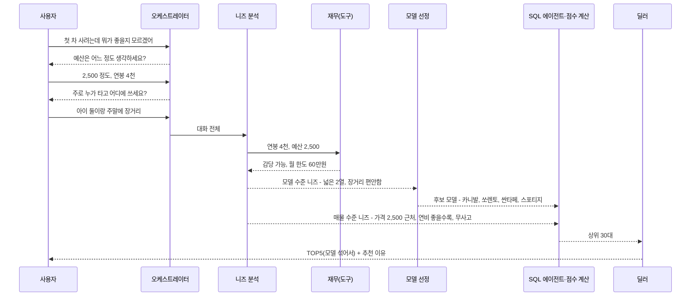
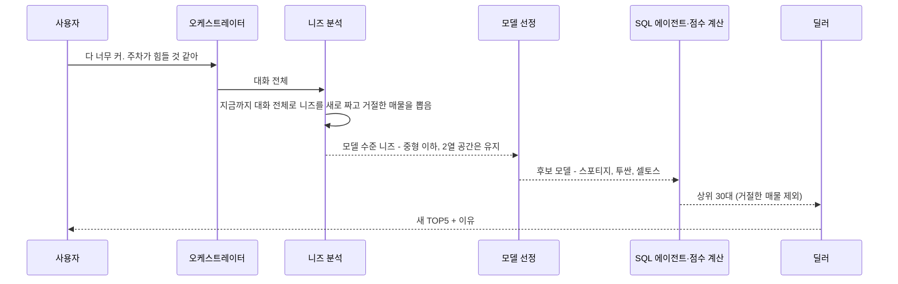
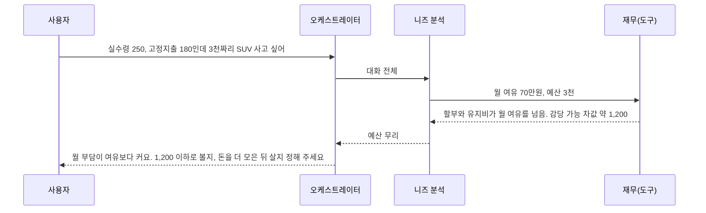
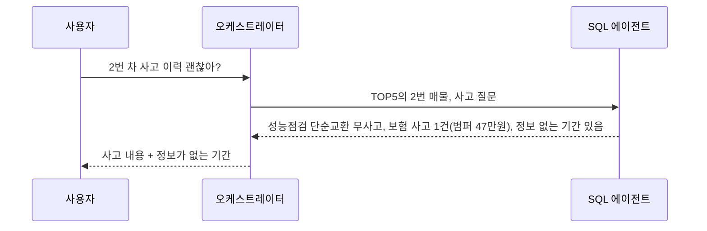
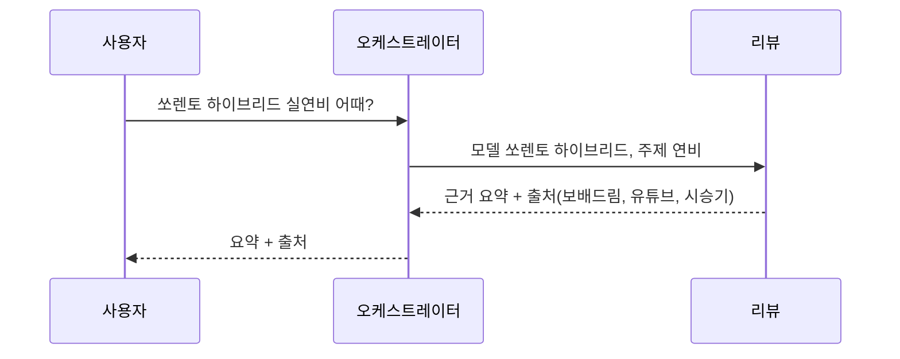
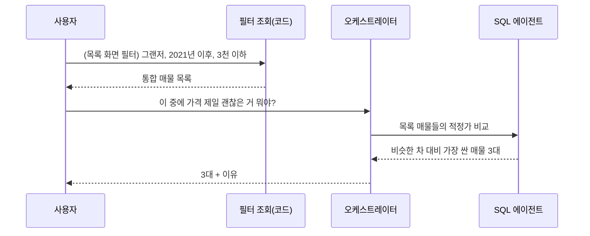

# 에이전트 설계

## 사용자

| 사용자 | 쓰는 방식 |
|---|---|
| 뭘 살지 모르는 사용자 (주 대상) | 처음부터 챗봇과 대화. 예산, 소득·월 여유, 용도·탑승 인원·보유 기간을 말함. 주행거리·가격·연식 같은 스펙은 선택값 |
| 살 차 기준이 정해진 사용자 | 통합 매물 목록(현대·기아·헤이딜러·케이카)을 필터로 보고, 옆 챗봇에 질문 |

## 니즈

니즈 분석 에이전트가 대화에서 세 가지를 뽑는다.

| 종류 | 예 | 쓰는 곳 |
|---|---|---|
| 필수 조건 | 디젤 제외, 사고차 제외 | SQL 에이전트가 매물을 거름 |
| 모델 수준 니즈 | 승차감, 실내 공간, 디자인 | 후보 모델을 고름 (같은 모델이면 매물마다 같으므로 순위에는 안 씀) |
| 매물 수준 니즈 | 가격 2,500 근처, 주행거리 적을수록, 무사고 | 매물 순위. 항목·목표·중요도를 에이전트가 정함 |

## 에이전트

에이전트는 LLM을 쓰는 단계다. 재무와 점수 계산은 LLM 없이 코드로 계산하는 도구이며, 아래 "도구"에 따로 적는다.

SQL 에이전트는 LLM이 SQL을 쓴다. 만든 SQL을 대화 상태에 저장해 두고 니즈가 바뀌지 않으면 다시 써서, 같은 니즈면 같은 매물이 나오게 한다. SQL은 읽기 전용으로 실행하고 SELECT만 허용한다. 화면의 필터는 조건이 이미 정해져 있어 SQL 에이전트를 거치지 않고 바로 조회한다.

| 이름 | 하는 일 | 입력 → 출력 |
|---|---|---|
| 오케스트레이터 | 사용자와 직접 대화. 부족한 정보를 한 번에 하나씩 질문하고, 나머지 메시지는 담당 에이전트로 보내고 그 결과를 사용자에게 전달 | 메시지 → 다음 질문 또는 담당 에이전트 |
| 니즈 분석 | 대화 전체를 니즈로 정리. 추천이 거절되면 니즈를 처음부터 새로 짜고 거절한 매물을 뽑음 | 대화 → 필수 조건, 모델 수준·매물 수준 니즈, 거절한 매물 |
| 모델 선정 | 모델 수준 니즈에 맞는 후보 모델 고르기 | 모델 수준 니즈 → 후보 모델 |
| 리뷰 | 모델에 대한 리뷰·커뮤니티 근거 찾기 | 모델 + 주제 → 근거 요약, 출처 |
| SQL 에이전트 | 요청을 SQL로 바꿔 매물 DB와 제원 DB를 조회. 추천에서는 필수 조건과 후보 모델로 매물을 거르고, 질문에서는 매물의 사고 이력·적정가 등을 조회 | 니즈 또는 질문 → 조회 결과 (추천에서는 매물 수백 대) |
| 딜러 | 5대를 골라 추천 이유 설명. 같은 모델은 많아야 2대 | 상위 30대 + 니즈 → TOP5 + 설명 |

## 도구

LLM 없이 코드로 계산한다. 같은 입력이면 항상 같은 결과가 나와야 하기 때문이다.

| 이름 | 하는 일 | 입력 → 출력 |
|---|---|---|
| 재무 | 소득·지출로 감당 가능한 예산 계산 | 재무 정보 → 예산 상한, 월 한도 |
| 점수 계산 | 매물 수준 니즈에 가까운 순으로 줄 세우기 | 매물 + 니즈 → 상위 30대 |

## 흐름

```
추천:   오케스트레이터 ⇄ 사용자 → 니즈 분석 (+재무) → 모델 선정 (↔리뷰) → SQL 에이전트 → 점수 계산 → 딜러 → TOP5
피드백: 사용자 → 오케스트레이터 → 니즈 분석이 니즈를 처음부터 새로 짬 → 모델 선정 → … → 딜러 (거절한 매물 제외)
질문:   사용자 → 오케스트레이터 → SQL 에이전트 또는 리뷰 → 오케스트레이터 → 답변
```

## 시나리오

시나리오의 숫자는 설명용 예시다.

### 1. 뭘 살지 모르는 사용자의 첫 대화



### 2. 마음에 안 들 때



### 3. 예산이 무리일 때



### 4. 특정 매물 질문



### 5. 모델 질문



### 6. 살 차 기준이 정해진 사용자



## 정할 것

- 점수 계산: 매물 수준 니즈의 목표에 "가까운 정도"를 어떻게 계산할지
- 딜러에게 넘길 상위 매물 수 (30대 제안)
- 재무: 월 여유 중 차량비로 쓸 수 있는 비율
