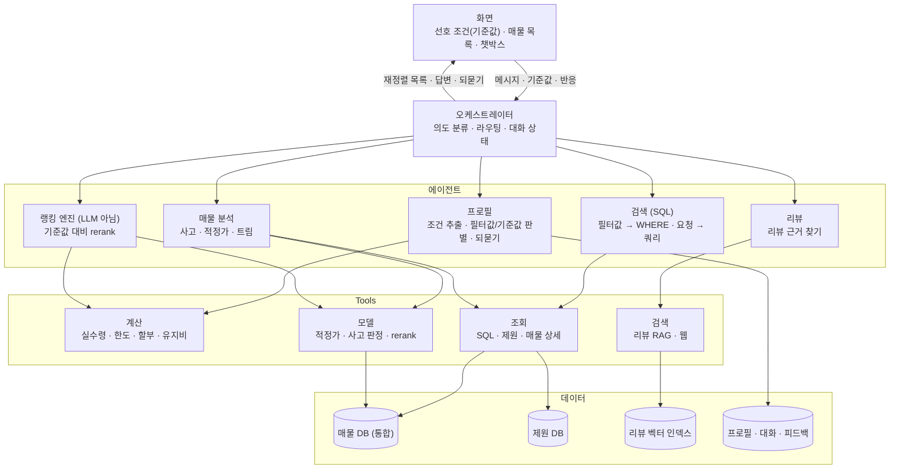

# 차 뭐사징?

- 작성자: Jaesik Jung
- 날짜: 2026-11-19

## 1. Introduction

기존 중고차 플랫폼과 같은 필터·목록 화면에 챗 에이전트를 붙여, 대화가 이어질수록 내 조건에 맞게 매물 순위가 다시 매겨지는 중고차 추천 시스템을 만든다.

### 1.1 문제 정의

기존 중고차 플랫폼은 차량 조건을 필터링하여 사용자가 원하는 조건의 차량을 보여준다. 그러나 이러한 차량 조건 필터링 기능은 다음과 같은 문제점들이 존재한다.

1. **강한 제약**: 필터링의 경우 선형적 사고방식을 유도하나 인간의 사고방식은 비선형적이다.
   - ex) "나는 3000만원 까지만 차를 사는데 쓸거다"라고 다짐을 했으나 2950만원의 그저 그런 매물과 3010만원의 좋은 매물의 경우 누구나 후자를 선택한다. 그러나 필터링 방식은 이러한 선택이 불가능하다.
2. **맞춤형 추천**: 좋은 차를 사려면 가격이 오를수록 좋은 차일 확률이 높다. 그러나 내 조건에 맞는 좋은 차를 사는 것은 다른 얘기다. 내 수익과 고정 지출, 자산 등 조건에 따라 사용자별 좋은 차는 유연하게 바뀌어야 한다.

조건이 안되면 뚜벅이로 살아라 해야하는데 중고차 플랫폼에서 이런 서비스가 나올리 없다. 또한 실제 컨슈머인사이트 추적 조사에 의하면 구입 의향자가 원하던 모델을 실제로 구매한 비율은 21% 밖에 안된다. 그리하여 우리의 목표는 사용자가 본인도 모르는 구매 결정 기준을 대화형 에이전트를 통해 결정하는데 도움을 받아 보다 합리적이며 만족할 수 있는 차량을 구매하도록 만드는 것이다.

## 2. User Scenario

1. 상단에 선호 조건을 입력한다. 해당 값은 필터가 아닌 기준값이다.
2. 에이전트가 필터값과 기준값을 판별한다. 기준값은 참고용 값, 필터값은 강한 제약조건이다.
3. SQL 에이전트가 필터값을 거르고 참고용 값 기준으로 제품을 추천한다.
4. 사용자가 해당 매물을 보고 질의응답을 통해 사용자에게 어울리는 매물을 추천한다.
5. 추천을 할 땐 추천 이유를 함께 설명한다. (있으면 좋고 없어도 상관없는 기능)

## 3. Data Collection

매물은 주요 중고차 플랫폼을 모두 모아 하나의 스키마로 합치고, 리뷰·커뮤니티 텍스트는 "사람들이 차를 살 때 무엇을 중요하게 보는가"와 "에이전트가 무엇을 물어야 하는가"를 분석하는 데 쓴다.

- **중고차 플랫폼**: 엔카, 케이카, 헤이딜러, 현대 인증중고차, 기아 인증중고차
- **리뷰, 커뮤니티**: 유튜브 차량 리뷰, 보배드림, 클리앙, 헤이딜러 후기, 자동차 매체 시승기

## 4. System Architecture
